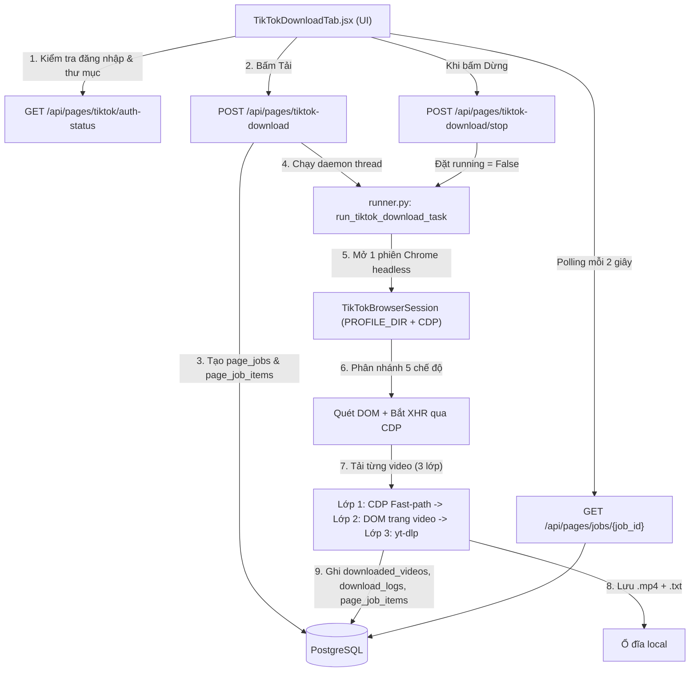

# Cơ chế Tìm kiếm và Tải video TikTok (Module 05)

Tài liệu này mô tả chi tiết cách Module 05 (`module_05_page_manager`) sử dụng phiên trình duyệt Chrome đã đăng nhập TikTok, kết hợp bắt DOM và Chrome DevTools Protocol (CDP) để tìm kiếm và tải video trực tiếp từ `tiktok.com` mà không sử dụng bất kỳ dịch vụ bên thứ ba nào.

---

## 1. Tổng quan kiến trúc

Toàn bộ luồng TikTok chỉ giao tiếp trực tiếp với `tiktok.com` và hệ thống CDN chính chủ của TikTok. Không sử dụng `tikwm`, `urlebird`, `ssstik`, `tiklydown` hay `FlareSolverr`.

| Thành phần | Vai trò |
| --- | --- |
| `frontend/src/modules/module_05_page_manager/components/TikTokDownloadTab.jsx` | Giao diện cấu hình thư mục lưu, số video/Page, đăng nhập TikTok, nhập từ khóa / link kênh / link video, bấm tải và theo dõi tiến trình qua polling `GET /api/pages/jobs/{job_id}` (2 giây/lần). |
| `modules/module_05_page_manager/routes_download.py` | Cung cấp API khởi chạy (`POST /api/pages/tiktok-download`), dừng job (`POST /api/pages/tiktok-download/stop`), kiểm tra đăng nhập (`/tiktok/auth-status`, `/tiktok/open-login`, `/tiktok/disconnect`), lưu cấu hình và xóa video. |
| `modules/module_05_page_manager/runner.py` | Điều phối `run_tiktok_download_task`: mở 1 phiên `TikTokBrowserSession` dùng chung cho cả job, phân nhánh 5 chế độ tìm kiếm, chống trùng, tải file, chuyển hashtag và ghi PostgreSQL (`downloaded_videos`, `download_logs`, `page_job_items`). |
| `core/media/tiktok_browser.py` | Quản lý hồ sơ Chrome đăng nhập (`PROFILE_DIR`), quét DOM trang tìm kiếm / trang kênh / trang video, và chặn bắt XHR nội bộ của TikTok qua CDP. |
| `core/media/tiktok_scraper.py` | Điều phối `search_tiktok_videos`, `fetch_tiktok_user_videos`, `download_tiktok_video`, tải luồng MP4 từ CDN bằng cookie phiên đăng nhập (`curl_cffi` / `requests`) và dự phòng bằng `yt-dlp` chính chủ. |

---

## 2. Phiên đăng nhập Chrome và lý do cần đăng nhập

### 2.1. Cách lưu và kiểm tra phiên đăng nhập

1. Khi người dùng bấm kết nối TikTok trên giao diện (`POST /api/pages/tiktok/open-login`), `open_tiktok_login_browser()` mở trình duyệt Chrome thật với:
   - `--user-data-dir={DATA_DIR}/browser_profiles/tiktok_profile` (`PROFILE_DIR`).
   - Tắt cờ tự động hóa (`--disable-blink-features=AutomationControlled`, ẩn `navigator.webdriver` qua CDP `Page.addScriptToEvaluateOnNewDocument`).
   - Điều hướng tới `https://www.tiktok.com/login`.
2. Luồng nền `_watch_tiktok_login()` kiểm tra cookie mỗi 2 giây. Khi phát hiện một trong các cookie xác thực (`sessionid`, `sessionid_ss`, `sid_tt`), hệ thống lưu phiên vào `data/tiktok_session.json` và tự đóng cửa sổ đăng nhập.
3. Khi kiểm tra trạng thái (`GET /api/pages/tiktok/auth-status`), hệ thống đọc `tiktok_session.json`; nếu chưa có thì đọc và giải mã trực tiếp SQLite cookie của Chrome (`Default/Network/Cookies` bằng Windows DPAPI + AES-GCM).
4. Giao diện chỉ cho phép kích hoạt tải khi `authStatus.connected == true` và đã chọn thư mục lưu.

### 2.2. Tại sao phải đăng nhập TikTok

- **Tìm kiếm (`/search/video?q=...`):** TikTok chặn mạnh trình duyệt khách (ép đăng nhập, trả trang rỗng hoặc hiện CAPTCHA) và các API tìm kiếm nội bộ yêu cầu chữ ký động (`X-Bogus`, `X-Gnarly`, `msToken`) do JavaScript trên trình duyệt đã đăng nhập sinh ra.
- **Cuộn trang kênh (`/@username`):** Trình duyệt không đăng nhập thường bị giới hạn chỉ tải được một số lượng nhỏ video đầu tiên hoặc bị chặn xác minh khi cuộn sâu (ảnh hưởng trực tiếp đến chế độ lọc từ khóa trong kênh).
- **Tải luồng CDN:** Các link MP4 web của TikTok (như `v16-webapp-prime`) đòi hỏi cookie phiên (`tt_chain_token`, `ttwid`, `msToken`, `sessionid`) khớp với `User-Agent` của trình duyệt vừa tải trang; nếu thiếu sẽ gặp lỗi HTTP 403.

---

## 3. Cơ chế bắt DOM kết hợp bắt XHR qua CDP

Khi job tải bắt đầu, `run_tiktok_download_task` khởi tạo duy nhất một phiên `TikTokBrowserSession` (Chrome `--headless=new`, `--mute-audio`, `--autoplay-policy=no-user-gesture-required`, dùng chung `PROFILE_DIR` và khóa bằng `_browser_session_lock` để tránh xung đột hồ sơ).

Phiên Chrome này bật đồng thời:
- `goog:loggingPrefs: {"performance": "ALL"}`
- `driver.execute_cdp_cmd("Network.enable", {})`

### 3.1. Bắt DOM (`_extract_dom_video_cards`)

Trên trang tìm kiếm hoặc trang kênh, JavaScript chạy trực tiếp trong trang sẽ:
1. Tìm vùng nội dung chính `document.querySelector('main') || document`.
2. Lấy tất cả thẻ `a[href*="/video/"]` và loại bỏ các link nằm trong `header`, `nav`, `aside`, hộp thoại thông báo (`inbox-notifications`, `inbox-list`).
3. Trích xuất `author` và `video_id` từ `href` theo biểu thức `tiktok.com/@([a-zA-Z0-9_.-]+)/video/(\d+)`.
4. Lấy caption/mô tả hiển thị trên card:
   - Trang tìm kiếm: ưu tiên `[data-e2e="search-card-video-caption"]`, `[data-e2e="search-card-desc"]`, `[data-e2e="video-desc"]`, `[class*="DivCardDesc"]`, `[class*="Caption"]`.
   - Trang kênh: ưu tiên `[data-e2e="user-post-item-desc"]`, `[class*="Caption"]`, `[class*="Desc"]`.
   - Nếu chưa có thì lấy `a.getAttribute('title')`, sau đó lấy `img[alt]` của ảnh thumbnail.

### 3.2. Bắt XHR nội bộ của TikTok qua CDP (`_drain_cdp_tiktok_items`)

Trong lúc Chrome đang tải và cuộn trang, hệ thống đọc log `performance` của Chrome để tìm các phản hồi HTTP 200 (`Network.responseReceived`) từ các endpoint chính chủ của TikTok:
- `/api/search/general/full`
- `/api/search/item/full`
- `/api/post/item_list`
- `/api/creator/item_list`
- `/api/item/detail`

Với mỗi `requestId` bắt được, hệ thống gọi `Network.getResponseBody` để giải mã JSON (hỗ trợ cả `base64Encoded`), sau đó bóc tách danh sách `itemStruct` (từ `data[].item`, `itemList`, `item_list`, hoặc `itemInfo.itemStruct`). Mỗi video thu được gồm:
- `video_id` (`id`)
- `author` (`author.uniqueId`)
- `title` (`desc` đầy đủ, không bị cắt ngắn như trên card DOM)
- `play_urls`: danh sách link MP4 không logo sắp xếp theo thứ tự ưu tiên:
  1. `video.bitrateInfo` có codec `h264`/`avc` (sắp xếp theo bitrate giảm dần để tương thích tối đa với Facebook Reels)
  2. Các luồng `video.bitrateInfo` còn lại
  3. `video.playAddr`
  4. `video.downloadAddr` (phương án cuối)
- `cookies` (lấy trực tiếp từ `driver.get_cookies()`) và `user_agent` (`navigator.userAgent`).

### 3.3. Hợp nhất DOM + CDP và cơ chế cuộn trang

- Trước mỗi lần mở URL mới, xóa hàng đợi log CDP cũ (`_clear_cdp_logs`).
- Chờ tối đa 12 giây cho đến khi xuất hiện card trên DOM hoặc dữ liệu XHR trong `cdp_cache`.
- Ở mỗi vòng lặp cuộn trang (`window.scrollBy(0, 1800)` cho tìm kiếm, `2000` cho kênh, nghỉ 2 giây mỗi lần cuộn):
  - Cập nhật thêm dữ liệu CDP mới vào `cdp_cache`.
  - Duyệt các card trên DOM theo đúng thứ tự hiển thị, đồng thời gắn `title` đầy đủ, `play_urls`, `cookies`, `user_agent` từ `cdp_cache` nếu trùng `video_id`.
  - Bổ sung thêm các video nằm trong `cdp_cache` nhưng đã bị TikTok ảo hóa (virtualize) khỏi DOM khi cuộn sâu.
  - Trước khi tìm, `runner.py` nạp sẵn `existing_ids` (các `video_id` đã tải trước đó và còn tồn tại trên ổ đĩa) để truyền vào `exclude_ids`: bộ cuộn chỉ tính vào mục tiêu `count` những video chưa từng tải, giúp luôn thu đủ số video mới cần thiết.
  - Dừng cuộn sớm khi đã đủ số video mới (`new_unseen >= count`), khi 3 lần cuộn liên tiếp không có video mới (`stalled >= 3`), khi đạt giới hạn số lần cuộn, hoặc khi người dùng bấm nút Dừng (`stop_check()`).

---

## 4. Chi tiết 5 chế độ tìm kiếm và tải

Trong `run_tiktok_download_task`, mỗi Fanpage có 2 trường đầu vào:
- `raw_kw`: từ khóa (`keyword` / `tiktok_keyword`)
- `raw_link`: đường dẫn (`link` / `tiktok_url`)

### Chế độ 1: Chỉ từ khóa (`KEYWORD_ONLY`)
- **Điều kiện:** `raw_link` trống, `raw_kw` có dữ liệu.
- **Tìm kiếm:**
  - Tách `raw_kw` theo dấu phẩy `,`, chấm phẩy `;`, hoặc xuống dòng `\n`.
  - Với mỗi từ khóa con, mở `https://www.tiktok.com/search/video?q={tu_khoa}` (nếu không ra kết quả thì thử `https://www.tiktok.com/search?q={tu_khoa}`).
  - Quét DOM + bắt XHR CDP cho tới khi gom đủ `needed` video chưa nằm trong `existing_ids` (tối đa 12 lần cuộn).
- **Tải:** Chạy quy trình tải 3 lớp (mục 5), có kiểm tra chống trùng.

### Chế độ 2: Từ khóa trong kênh (`KEYWORD_IN_PROFILE`)
- **Điều kiện:** `raw_link` là link kênh / `@username` (không chứa `/video/`, `vm.tiktok.com/`, `vt.tiktok.com/`, hay ID 15-22 chữ số) và `raw_kw` có dữ liệu.
- **Tìm kiếm:**
  1. Tách `u_name` từ `raw_link` và gán `target_channel = u_name`.
  2. Mở `https://www.tiktok.com/@{u_name}`, quét DOM + bắt XHR CDP (tối đa 18 lần cuộn), chỉ giữ video của đúng `@u_name`, dừng cuộn khi đủ `max_videos` video chưa trùng và khớp từ khóa.
  3. Lọc caption cục bộ với danh sách `sub_kws`:
     - Lượt 1 (ưu tiên): caption chứa nguyên cụm từ khóa hoặc chứa đầy đủ tất cả các từ đơn trong từ khóa.
     - Lượt 2 (chỉ chạy nếu Lượt 1 không có kết quả): caption chứa bất kỳ từ đơn nào trong từ khóa.
  4. **Dự phòng:** Nếu quét trang kênh không có video nào khớp từ khóa, chuyển sang tìm kiếm DOM `https://www.tiktok.com/search/video?q={u_name}+{kw}` và lọc chặt chỉ giữ video có `author == u_name` hoặc `source_url` chứa `@{u_name}`.
- **Tải:** Chạy quy trình tải 3 lớp, có ràng buộc đúng kênh `@u_name` và chống trùng.

### Chế độ 3: Chỉ kênh (`PROFILE_ONLY`)
- **Điều kiện:** `raw_link` là link kênh / `@username`, `raw_kw` trống.
- **Tìm kiếm:**
  1. Tách `u_name` và gán `target_channel = u_name`.
  2. Mở `https://www.tiktok.com/@{u_name}`, quét DOM + bắt XHR CDP (tối đa 18 lần cuộn) đến khi đủ `max_videos` video mới chưa trùng của đúng `@u_name`.
  3. **Dự phòng:** Nếu trang kênh trả về rỗng, tìm kiếm DOM với từ khóa `u_name` và lọc chặt chỉ giữ video của `@u_name`.
- **Tải:** Chạy quy trình tải 3 lớp, có ràng buộc đúng kênh `@u_name` và chống trùng.

### Chế độ 4: Link video trực tiếp (`DIRECT_LINK`)
- **Điều kiện:** `raw_link` chứa ít nhất một mục có `/video/`, `vm.tiktok.com/`, `vt.tiktok.com/`, hoặc chuỗi ID 15-22 chữ số. Chế độ này được ưu tiên kiểm tra trước `raw_kw`.
- **Tìm kiếm:** Không quét trang tìm kiếm hay trang kênh. Tách danh sách link theo `,`, `;`, khoảng trắng hoặc xuống dòng và lấy tối đa `max_videos` link.
- **Tải:**
  - Bỏ qua kiểm tra chống trùng (`is_direct_url = True`) để cho phép tải lại link trực tiếp người dùng chủ động dán vào.
  - Vì chưa có `play_urls` từ bước tìm kiếm, `download_tiktok_video` đi thẳng vào Lớp 2 (mở từng link video bằng Chrome đã đăng nhập để theo dõi redirect của `vm.tiktok.com`/`vt.tiktok.com`, lấy đúng `video_id` chính thức, caption đầy đủ và link CDN) rồi tải về.

### Chế độ 5: Không nhập gì — fallback theo tên Fanpage (`KEYWORD_ONLY`)
- **Điều kiện:** Cả `raw_kw` và `raw_link` đều rỗng.
- **Xử lý:** Gán `raw_kw = page_name` (hoặc `Page_{page_id}` nếu thiếu tên).
- **Tìm kiếm và tải:** Chạy hoàn toàn giống **Chế độ 1 (Chỉ từ khóa)** bằng tên Fanpage, có chống trùng.

---

## 5. Quy trình tải video 3 lớp (`download_tiktok_video`)

Với mỗi video ứng viên đã chọn, `download_tiktok_video(direct_url, f_path, driver=driver, stop_check=is_tiktok_stopped, prefetched_meta=v)` thực hiện lần lượt:

### Lớp 1: Tải nhanh từ XHR đã bắt sẵn (Fast-path, không cần mở trang video)
- Áp dụng cho Chế độ 1, 2, 3, 5 khi bước tìm kiếm/quét kênh đã bắt được `play_urls` qua CDP.
- Lấy cookie mới nhất từ `driver.get_cookies()` (hoặc cookie gắn kèm trong `prefetched_meta`) và `User-Agent` khớp với Chrome.
- Gọi `download_stream_to_file()` để stream trực tiếp từ TikTok CDN:
  - Gửi header `Referer: https://www.tiktok.com/`, `Origin: https://www.tiktok.com`, `Range: bytes=0-`, `Sec-Fetch-Dest: video`.
  - Thử bằng `curl_cffi` (`impersonate="chrome124"`) ở 2 lần đầu để khớp TLS fingerprint của Chrome, lần thứ 3 dùng `requests`.
  - Từ chối nếu `Content-Type` là `text/` hoặc `application/json`.
  - Ghi file theo từng khối 256 KB (kiểm tra `stop_check()` trong quá trình ghi để dừng ngay khi người dùng hủy).
  - Xác thực file sau tải bằng `_is_valid_video_file`: tồn tại, dung lượng `> 1000` bytes và 64 byte đầu không bắt đầu bằng `<html`, `<!doctype` hoặc `{`.
- Nếu thành công: kết thúc ngay mà không cần điều hướng Chrome sang trang video.

### Lớp 2: Mở trang video trên DOM (`resolve_tiktok_video_via_browser`)
- Chạy trong Chế độ 4 (Link trực tiếp) hoặc khi Lớp 1 không có `play_urls` / link CDN đã hết hạn (HTTP 403).
- Chrome mở trực tiếp URL video và chờ tối đa 10 giây để trang nạp xong `<video>` hoặc thẻ `<script id="__UNIVERSAL_DATA_FOR_REHYDRATION__">`.
- Đọc `itemStruct` trong `__DEFAULT_SCOPE__["webapp.video-detail"]["itemInfo"]["itemStruct"]` kết hợp với DOM:
  - Lấy `video_id`, `author`, `title` (ưu tiên `itemStruct.desc` -> `[data-e2e="browse-video-desc"]` / `[data-e2e="video-desc"]` -> `meta[name="description"]`).
  - Gom danh sách `play_urls`: H.264 `bitrateInfo` -> `bitrateInfo` khác -> `video.playAddr` -> `<video>` `currentSrc`/`src`/`<source>` (loại `blob:`) -> `video.downloadAddr`.
  - Lấy cookie tươi từ `driver.get_cookies()` và thử `download_stream_to_file()` qua từng URL.

### Lớp 3: Dự phòng bằng `yt-dlp` chính chủ (`download_tiktok_video_ytdlp`)
- Chỉ chạy nếu cả Lớp 1 và Lớp 2 đều không stream được MP4 (ví dụ video chỉ phát qua `blob:` MSE).
- Xuất cookie phiên đăng nhập TikTok ra file Netscape tạm (`tt_cookies_*.txt`).
- Gọi `yt_dlp.YoutubeDL` trực tiếp tới URL `tiktok.com` với `cookiefile` vừa xuất, `merge_output_format="mp4"`, `Referer: https://www.tiktok.com/`.
- Xóa file cookie tạm trong khối `finally`.

---

## 6. Lưu trữ, chuyển đổi hashtag, chống trùng và reset bộ đếm thư mục

1. **Cấu trúc thư mục lưu:**
   ```text
   {download_folder}/{safe_page_name}/{so_thu_tu}/{video_id}.mp4
   {download_folder}/{safe_page_name}/{so_thu_tu}/{video_id}.txt
   ```
   - `so_thu_tu` tăng dần (`1`, `2`, `3`, ...) được cấp phát an toàn luồng qua `_allocate_video_subfolder()` (`max(thu_muc_so_hien_co) + 1`, hoặc `1` nếu chưa có).
   - Nếu link rút gọn (`vm.tiktok.com`/`vt.tiktok.com`) cho ra `video_id` thật sau khi redirect, file được đổi tên thành `{final_vid}.mp4`.
   - Nếu tải thất bại, `_cleanup_failed_subfolder()` xóa sạch thư mục con vừa tạo để không để lại thư mục rỗng.
2. **Chuyển đổi hashtag cho Facebook Reels:**
   - File `.txt` đi kèm lưu caption đã đổi các hashtag TikTok sang Facebook qua `convert_tiktok_hashtags_to_facebook()`:
     - `#fyp`, `#foryou` -> `#reels`
     - `#xuhuong`, `#tiktok` -> `#facebook`
     - `#tik_tok` -> `#fb`
     - `#trending`, `#fypシ` -> `#viral`
3. **Cơ sở dữ liệu PostgreSQL:**
   - `downloaded_videos`: lưu `(page_id, video_id, source='TIKTOK', title, object_path, download_mode)` để chống trùng (kiểm tra cả bản ghi DB lẫn file vật lý `> 1000` bytes trên ổ đĩa).
   - `download_logs`: ghi nhật ký mỗi lần tải `SUCCESS` / `FAILED`.
   - `page_jobs` và `page_job_items`: cập nhật trạng thái thời gian thực cho giao diện.
4. **Reset bộ đếm thư mục khi xóa toàn bộ:**
   - Khi bấm xóa toàn bộ theo từng Fanpage (`DELETE /api/pages/{page_id}/videos`) hoặc xóa toàn bộ hệ thống (`DELETE /api/pages/all-videos`), `_wipe_page_folder_tree()` dùng `shutil.rmtree` xóa dứt điểm các thư mục con dạng số (đồng thời giữ nguyên thư mục của nguồn còn lại nếu TikTok và YouTube dùng chung thư mục), và đặt lại `posting_progress.last_folder_index = 0` khi Page không còn video nào. Lần tải tiếp theo sẽ bắt đầu lại từ thư mục `1`.
   - Xóa lẻ 1 video (`DELETE /api/pages/{page_id}/videos/{video_db_id}`) không theo dõi hay reset bộ đếm thư mục.

---

## 7. Luồng tổng thể end-to-end



Diễn giải trình tự thực thi:
1. Giao diện kiểm tra `authStatus.connected` và `downloadFolder`, đồng bộ trước `tiktok_keyword` / `tiktok_url` của các Page nếu có thay đổi.
2. `POST /api/pages/tiktok-download` kiểm tra không có job `TIKTOK` khác đang chạy (`is_job_running("TIKTOK")`), lưu `download_folder` và `max_videos` xuống file cấu hình, tạo bản ghi `page_jobs` + `page_job_items`, đánh dấu `_active_jobs["TIKTOK"]` đang chạy và khởi chạy `run_tiktok_download_task` trong một daemon thread.
3. Trong suốt vòng đời job, `runner.py` giữ duy nhất một `TikTokBrowserSession` và xử lý tuần tự từng Fanpage.
4. Giao diện gọi `GET /api/pages/jobs/{job_id}` mỗi 2 giây để cập nhật trạng thái từng Page (`PENDING`, `RUNNING`, `SUCCESS`, `FAILED`) cho tới khi `job.status == "FINISHED"`.
5. Khi hoàn tất hoặc gặp ngoại lệ, khối `finally` luôn đóng trình duyệt Chrome (`browser_session.close()`), cập nhật `page_jobs.status = 'FINISHED'` và giải phóng cờ `_active_jobs["TIKTOK"]`.

---

## 8. Cơ chế khóa đồng thời và dừng tác vụ an toàn

### 8.1. Các khóa (Lock) đang sử dụng

| Khóa | Vị trí | Mục đích |
| --- | --- | --- |
| `_jobs_lock` | `modules/module_05_page_manager/runner.py` | Bảo vệ `_active_jobs["TIKTOK"]`, ngăn khởi chạy đồng thời 2 job tải TikTok và đồng bộ cờ dừng giữa API thread và worker thread. |
| `_live_driver_lock` | `core/media/tiktok_browser.py` | Bảo vệ cửa sổ Chrome đăng nhập `_live_driver`. Khi Chrome headless bắt đầu chạy, hệ thống tự đóng `_live_driver` nếu đang mở để tránh lỗi khóa hồ sơ Chrome (`PROFILE_DIR`). |
| `_browser_session_lock` | `core/media/tiktok_browser.py` | Đảm bảo tại một thời điểm chỉ có duy nhất một phiên headless Chrome truy cập `PROFILE_DIR`. |
| `_folder_num_lock` | `modules/module_05_page_manager/runner.py` | Bảo vệ việc tính `get_next_folder_number()` và tạo thư mục con đánh số `1`, `2`, `3`, ... tránh trùng số thư mục. |

### 8.2. Cơ chế dừng giữa chừng (`stop_check`)

Khi người dùng bấm Dừng (`POST /api/pages/tiktok-download/stop`):
1. `stop_job("TIKTOK")` đặt `_active_jobs["TIKTOK"]["running"] = False`.
2. Hàm `is_tiktok_stopped()` được truyền xuyên suốt xuống mọi vòng lặp:
   - Vòng chờ tải trang (kiểm tra mỗi 1 giây) và vòng cuộn DOM/CDP trên trang tìm kiếm, trang kênh, trang video.
   - Vòng lặp ghi từng khối 256 KB trong `download_stream_to_file()`: nếu bị dừng giữa chừng, file `.mp4` tải dở lập tức bị xóa khỏi ổ đĩa và thư mục con vừa cấp phát được dọn sạch bởi `_cleanup_failed_subfolder()`.
   - Vòng lặp giữa các video và giữa các Fanpage trong `run_tiktok_download_task`.
3. Các video đã tải hoàn chỉnh trước thời điểm bấm Dừng vẫn được giữ nguyên trên ổ đĩa và trong `downloaded_videos`; các Page chưa chạy được dọn trạng thái chờ, và Chrome headless được đóng sạch sẽ trong `finally`.

---

## 9. Hạn chế đã biết và hướng xử lý sự cố

| Tình huống | Nguyên nhân | Cách xử lý |
| --- | --- | --- |
| Tìm kiếm hoặc quét kênh trả về 0 video dù từ khóa/kênh hợp lệ | TikTok hiện CAPTCHA xác minh trên Chrome headless hoặc phiên đăng nhập đã hết hạn / bị đăng xuất. | Bấm **Đăng xuất** rồi **Đăng nhập lại TikTok** trên giao diện để làm mới cookie và vượt xác minh trên cửa sổ Chrome hiện hữu; ưu tiên dùng tài khoản TikTok phụ thay vì tài khoản chính. |
| Lỗi không khởi động được Chrome headless | Hồ sơ `PROFILE_DIR` đang bị khóa bởi một tiến trình Chrome treo trước đó hoặc thiếu trình duyệt Google Chrome trên máy. | Đóng các tiến trình Chrome còn sót lại liên quan đến `tiktok_profile` và kiểm tra máy đã cài đặt Google Chrome. |
| Tải chậm hơn bình thường (rơi xuống Lớp 2 hoặc Lớp 3) | TikTok thay đổi tên endpoint XHR nên CDP không bắt được `play_urls` trước, hoặc link CDN đã hết hạn trước khi tải. | Hệ thống tự động fallback sang mở trang video trên DOM (Lớp 2) và `yt-dlp` chính chủ (Lớp 3). Nếu tình trạng xảy ra thường xuyên, kiểm tra và bổ sung tên endpoint mới vào danh sách `target_paths` trong `_drain_cdp_tiktok_items()`. |
| Caption bị rút gọn hoặc thiếu dấu | Chỉ bắt được text trên card DOM khi XHR không trả về hoặc TikTok đổi `data-e2e` selector. | Kiểm tra và cập nhật danh sách selector trong `_extract_dom_video_cards()` và `_resolve_video_with_driver()` tại `core/media/tiktok_browser.py`. |
| Tải nhiều video cùng lúc bị TikTok giới hạn tạm thời | Tần suất cuộn trang và gọi CDN cao trong thời gian ngắn trên cùng một tài khoản/IP. | Giảm số video mỗi lần tải, chạy theo từng đợt nhỏ hoặc đổi sang tài khoản TikTok phụ khác. |

